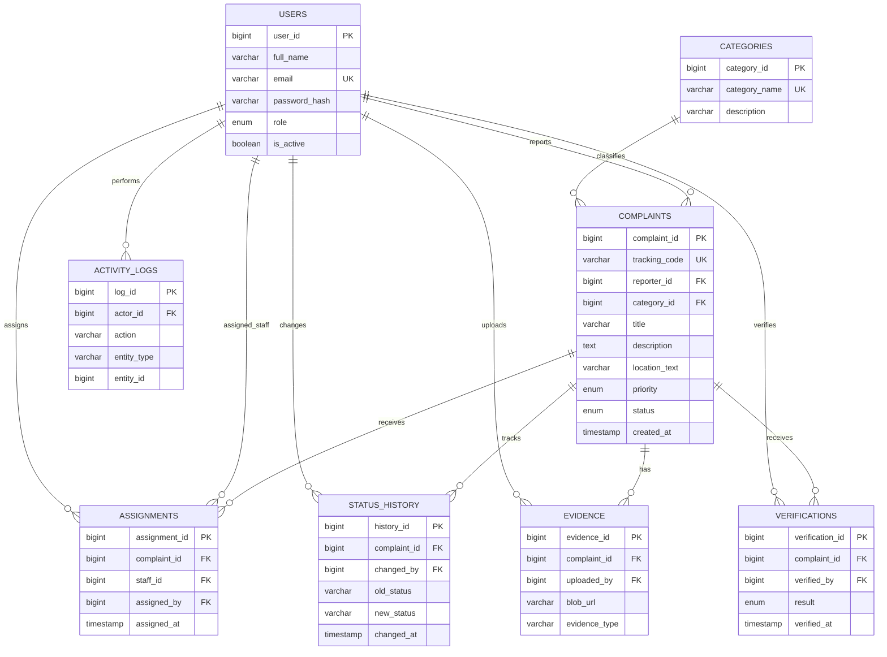
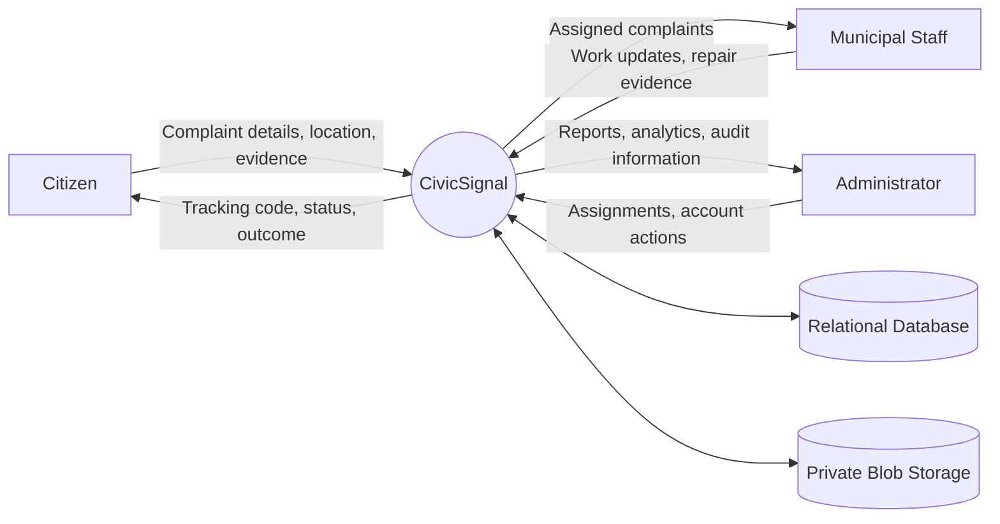
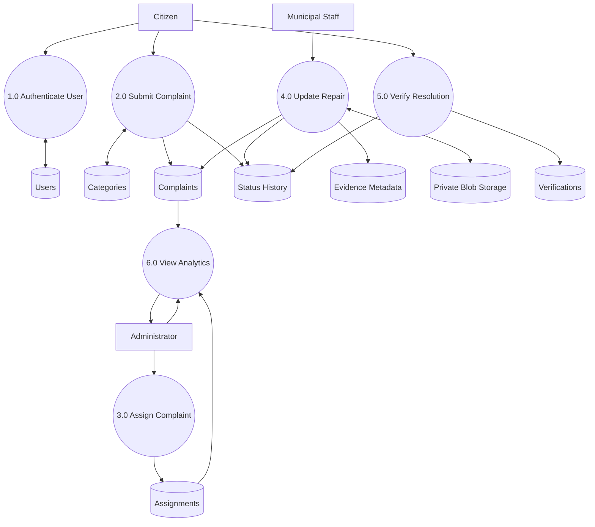
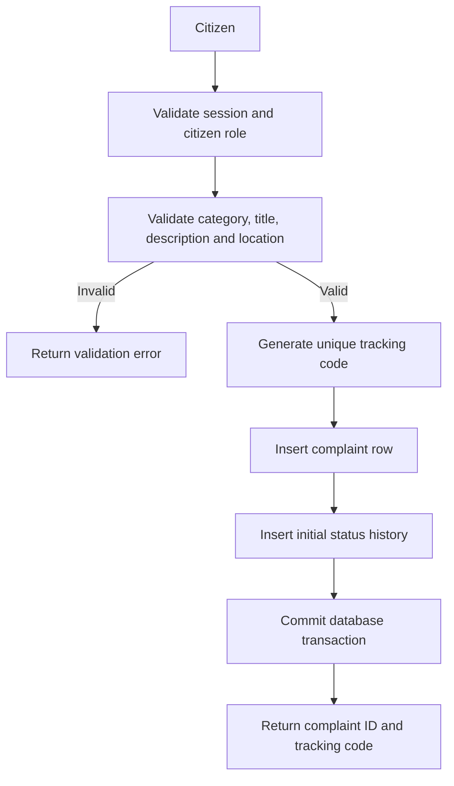

# CivicSignal – ER Diagram and DFDs

## ER diagram (Mermaid)

## DFD Level 0 – Context diagram

## DFD Level 1 – Main processes

## DFD Level 2 – Complaint submission

## Notes for the report
- USERS has three roles: citizen, staff and admin.
- A complaint belongs to exactly one reporter and one category.
- A complaint may have multiple assignment records over time.
- Status history records each workflow transition.
- Evidence binaries live in private Blob Storage; the relational database stores metadata and storage references.
- Analytics are derived from relational complaint, assignment and status data.
